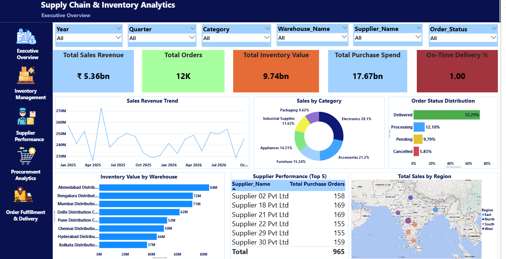
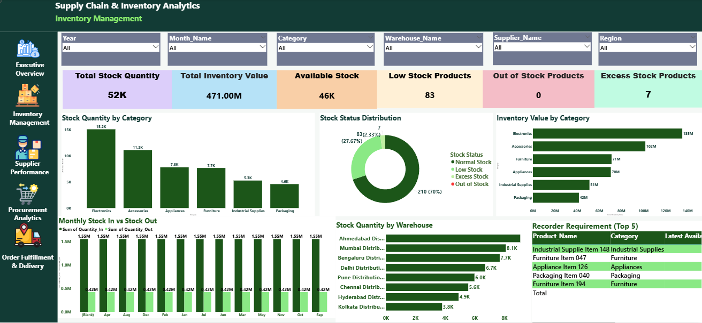
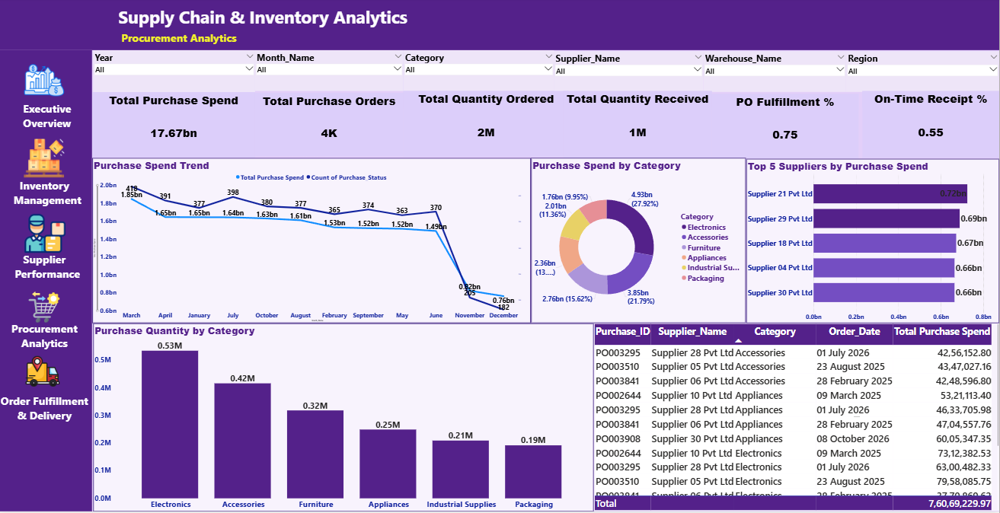
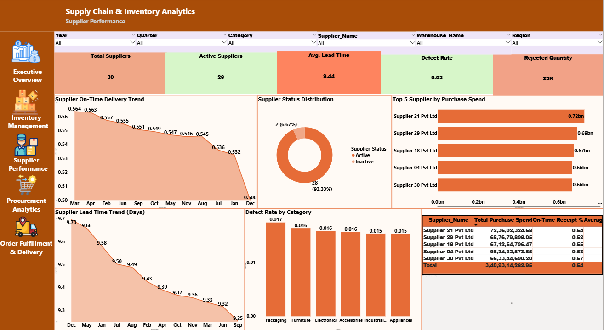
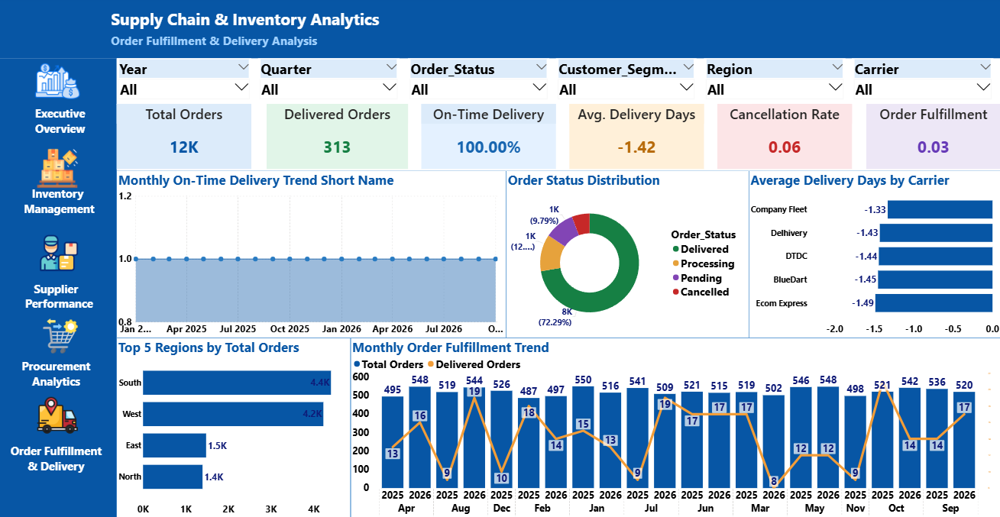

# 📦 Supply Chain & Inventory Analytics | Power BI Project

## 📌 Project Overview

The **Supply Chain & Inventory Analytics Dashboard** is an end-to-end Business Intelligence project developed using Microsoft Power BI.

The project focuses on analyzing supply chain operations, inventory management, procurement activities, supplier performance, and order fulfillment.

It uses a synthetic dataset containing **154,837 records across 13 tables** to transform raw operational data into meaningful business insights through interactive dashboards and KPIs.

The objective is to help businesses monitor operational performance, identify potential risks, optimize inventory, evaluate supplier reliability, and improve supply chain efficiency.

---

## 🎯 Project Objectives

- Analyze overall supply chain performance.
- Monitor inventory levels and stock availability.
- Identify low-stock and excess-stock products.
- Analyze procurement spending and purchase orders.
- Evaluate supplier reliability and performance.
- Monitor order fulfillment and delivery efficiency.
- Identify operational issues and business risks.
- Generate actionable business recommendations.

---

## 📊 Power BI Dashboard Preview

This project contains **5 interactive dashboards**.

### 1. Executive Overview

Provides a high-level overview of the entire supply chain operation.

**Key KPIs:**
- Total Sales Revenue
- Total Orders
- Total Inventory Value
- Total Purchase Spend
- On-Time Delivery %

**Visualizations:**
- Sales Revenue Trend
- Sales by Category
- Order Status Distribution
- Inventory Value by Warehouse
- Top 5 Suppliers by Performance
- Sales by Region



---

### 2. Inventory Management

Analyzes inventory levels, stock availability, and replenishment requirements across products and warehouses.

**Key KPIs:**
- Latest Stock Quantity
- Latest Inventory Value
- Available Stock
- Low Stock Products
- Out-of-Stock Products
- Excess Stock Products

**Visualizations:**
- Stock Quantity by Category
- Stock Status Distribution
- Inventory Value by Category
- Monthly Stock In vs Stock Out
- Stock Quantity by Warehouse
- Reorder Requirements – Top 5 Products



---

### 3. Procurement Analytics

Provides insights into purchasing activities, procurement costs, and purchase order fulfillment.

**Key KPIs:**
- Total Purchase Spend
- Total Purchase Orders
- Total Quantity Ordered
- Total Quantity Received
- Purchase Order Fulfillment %
- On-Time Receipt %

**Visualizations:**
- Purchase Spend Trend
- Purchase Spend by Category
- Top 5 Suppliers by Purchase Spend
- Purchase Quantity by Category
- Average Purchase Price Trend
- Recent High-Value Purchase Orders



---

### 4. Supplier Performance

Evaluates supplier reliability, delivery performance, lead time, and product quality.

**Key KPIs:**
- Total Suppliers
- Active Suppliers
- On-Time Receipt %
- Average Lead Time
- Defect Rate %
- Rejected Quantity

**Visualizations:**
- Supplier On-Time Delivery Trend
- Supplier Status Distribution
- Top 5 Suppliers by Purchase Spend
- Supplier Lead Time Trend
- Defect Rate by Category
- Supplier Performance Scorecard



---

### 5. Order Fulfillment & Delivery

Analyzes customer orders, shipment performance, delivery efficiency, and order fulfillment.

**Key KPIs:**
- Total Orders
- Delivered Orders
- On-Time Delivery %
- Average Delivery Days
- Cancellation Rate %
- Order Fulfillment %

**Visualizations:**
- Monthly On-Time Delivery Trend
- Order Status Distribution
- Average Delivery Days by Carrier
- Top 5 Regions by Total Orders
- Monthly Order Fulfillment Trend



---

## 🗂️ Dataset Information

The project uses a synthetic supply chain dataset containing **13 CSV files**.

### Dimension Tables

| Table Name | Records | Description |
|---|---:|---|
| Dim_Products | 300 | Product information |
| Dim_Suppliers | 30 | Supplier details |
| Dim_Warehouses | 8 | Warehouse information |
| Dim_Customers | 1,500 | Customer details |
| Dim_Date | 730 | Date dimension |

### Fact Tables

| Table Name | Records | Description |
|---|---:|---|
| Fact_PurchaseOrders | 4,200 | Purchase order information |
| Fact_PurchaseOrderDetails | 10,417 | Purchase order line items |
| Fact_SalesOrders | 11,500 | Sales order information |
| Fact_SalesOrderDetails | 28,621 | Sales order line items |
| Fact_InventorySnapshots | 52,800 | Inventory snapshot records |
| Fact_StockMovements | 32,791 | Stock movement records |
| Fact_Shipments | 10,830 | Shipment and delivery details |
| Fact_Returns | 1,138 | Product return records |

### Dataset Summary

| Attribute | Details |
|---|---|
| Total Tables | 13 |
| Dimension Tables | 5 |
| Fact Tables | 8 |
| Total Records | 154,837 |
| Dataset Period | January 2025 – October 2026 |
| Currency | Indian Rupees (INR) |
| Data Format | CSV |
| Data Type | Synthetic Training Dataset |

---

## 🛠️ Tools & Technologies

| Tool | Purpose |
|---|---|
| Microsoft Power BI Desktop | Dashboard development and visualization |
| Power Query | Data cleaning and transformation |
| DAX | KPI calculations and business measures |
| Microsoft Excel | Data inspection and validation |
| CSV | Source dataset format |

---

## 🔄 Project Workflow

1. Dataset collection and exploration
2. Data understanding and profiling
3. Data cleaning and transformation using Power Query
4. Data validation and quality checks
5. Data modeling and relationship creation
6. DAX measure development
7. Interactive dashboard development
8. Business analysis and insight generation
9. Business recommendations and documentation

---

## 🧹 Data Cleaning & Validation

Data cleaning and validation were performed to improve the reliability and consistency of the dataset.

**Key activities:**

- Identified missing and blank values.
- Checked duplicate records.
- Validated primary and foreign key relationships.
- Checked negative and invalid quantities.
- Validated sales calculations.
- Checked purchase order quantities.
- Validated inventory calculations.
- Reviewed stock movement records.
- Identified shipment date inconsistencies.

**Data Quality Note:**

Shipment records contained date-order anomalies, including actual delivery dates earlier than dispatch dates. These records were identified for review rather than silently corrected or removed.

---

## 📐 Data Modeling

The project uses a dimensional data model consisting of:

- 5 Dimension Tables
- 8 Fact Tables

Dimension tables provide descriptive information, while fact tables contain transactional and operational data.

Relationships connect products, suppliers, warehouses, customers, dates, purchase orders, sales orders, inventory, shipments, and returns.

The data model supports cross-functional analysis through related tables and interactive filtering.

---

## 📈 DAX & KPI Analysis

DAX was used to create measures and calculate important business performance indicators.

**Key calculations include:**

- Total Sales Revenue
- Total Orders
- Total Purchase Spend
- Total Inventory Value
- Latest Stock Quantity
- Available Stock
- Low Stock Products
- Excess Stock Products
- Purchase Order Fulfillment %
- On-Time Receipt %
- Average Lead Time
- Defect Rate %
- Delivered Orders
- On-Time Delivery %
- Average Delivery Days
- Cancellation Rate %
- Order Fulfillment %

---

## 💡 Business Insights

The dashboards provide insights into different areas of supply chain operations.

**Sales Analysis**
- Understand sales performance across product categories and regions.
- Track sales trends over time.
- Monitor order status distribution.

**Inventory Analysis**
- Identify products with low stock levels.
- Monitor inventory value across warehouses.
- Identify products requiring replenishment.

**Procurement Analysis**
- Analyze procurement spending patterns.
- Monitor purchase order fulfillment.
- Compare purchase quantities and supplier costs.

**Supplier Analysis**
- Evaluate supplier delivery reliability.
- Monitor average lead time.
- Identify rejected quantities and quality issues.

**Order Fulfillment Analysis**
- Monitor delivery performance.
- Analyze average delivery days by carrier.
- Track cancellation and order fulfillment rates.

---

## 💼 Business Recommendations

Based on the analysis, businesses can consider the following actions:

1. Maintain appropriate safety stock for products with low inventory.
2. Prioritize replenishment for products below reorder levels.
3. Monitor suppliers with low on-time receipt performance.
4. Review rejected quantities to identify supplier quality issues.
5. Optimize procurement spending by comparing supplier costs.
6. Investigate shipment delays and delivery date inconsistencies.
7. Monitor cancellation rates to improve order fulfillment.
8. Use inventory and sales trends to support demand planning.

---

## 📁 Repository Structure

```text
Supply-Chain-Inventory-Analytics/
│
├── Dashboard/
│   └── Images/
│       ├── Executive_Overview.png
│       ├── Inventory_Management.png
│       ├── Procurement_Analytics.png
│       ├── Supplier_Performance.png
│       └── Order_Fulfillment.png
│
├── Dataset/
│   ├── Dim_Products.csv
│   ├── Dim_Suppliers.csv
│   ├── Dim_Warehouses.csv
│   ├── Dim_Customers.csv
│   ├── Dim_Date.csv
│   ├── Fact_PurchaseOrders.csv
│   ├── Fact_PurchaseOrderDetails.csv
│   ├── Fact_SalesOrders.csv
│   ├── Fact_SalesOrderDetails.csv
│   ├── Fact_InventorySnapshots.csv
│   ├── Fact_StockMovements.csv
│   ├── Fact_Shipments.csv
│   └── Fact_Returns.csv
│
├── Documentation/
│   ├── Project_Overview.md
│   ├── Data_Model.md
│   ├── DAX_Measures.md
│   └── Business_Insights.md
│
├── Dashboard/
│   └── Supply_Chain_Inventory_Analytics.pbix
│
└── README.md
```

---

## 🚀 How to Use

1. Clone or download this repository.
2. Download the dataset files from the `Dataset` folder.
3. Open the Power BI `.pbix` file using Power BI Desktop.
4. If prompted, update the data source paths.
5. Refresh the dataset.
6. Explore the five interactive dashboards using slicers and filters.

---

## 📌 Project Information

| Attribute | Details |
|---|---|
| Project Name | Supply Chain & Inventory Analytics |
| Domain | Supply Chain Management & Business Intelligence |
| Tool | Microsoft Power BI |
| Dataset | 154,837 Records |
| Tables | 13 |
| Dashboards | 5 |
| Currency | INR |
| Project Type | End-to-End Data Analytics Project |

---

⭐ If you find this project useful, feel free to explore the repository and share your feedback.
